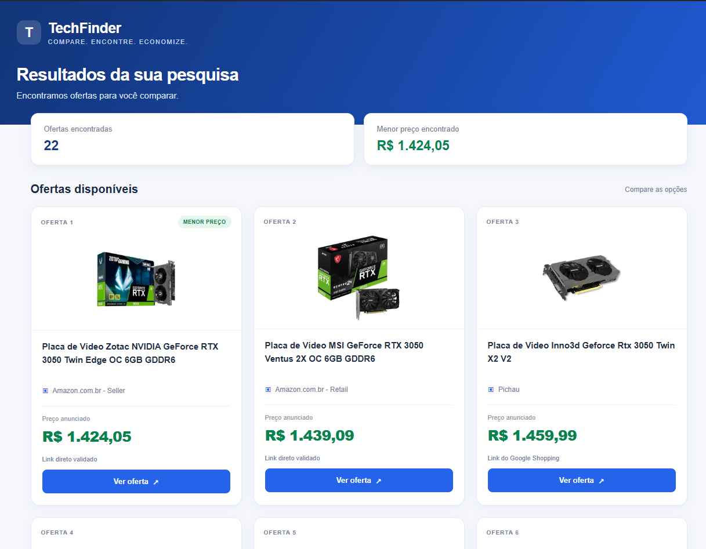
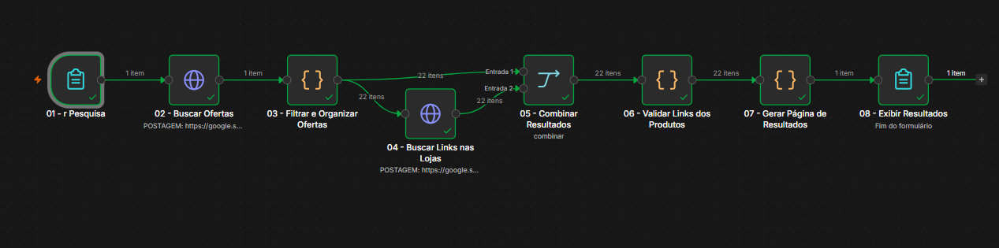

 <div align="center">


# Comparador de Preços de Tecnologia

**Encontre ofertas, compare preços e simplifique suas pesquisas de produtos.**


</div>

---

## Sobre o projeto

O **TechFinder** é um projeto de automação desenvolvido utilizando **n8n**, com o objetivo de facilitar a pesquisa e comparação de preços de produtos de tecnologia em diferentes lojas.

Pesquisar um mesmo produto em diversos sites pode ser um processo demorado. É necessário repetir buscas, analisar resultados, comparar preços e verificar se as ofertas correspondem ao produto desejado.

O TechFinder automatiza essas etapas, reunindo os resultados em uma única interface.

## Problema identificado

A pesquisa manual de preços apresenta alguns desafios:

- Necessidade de acessar diferentes lojas para comparar ofertas.
- Dificuldade para identificar rapidamente os menores preços.
- Resultados de pesquisa que podem apresentar modelos ou versões diferentes.
- Links que nem sempre direcionam diretamente para o produto anunciado.
- Tempo gasto na organização e comparação das informações.

**Objetivo:** desenvolver uma automação capaz de pesquisar produtos, organizar ofertas e apresentar opções de compra de maneira simples e centralizada.

## Solução desenvolvida

O TechFinder recebe o nome de um produto por meio de um formulário e executa automaticamente uma sequência de consultas e validações.

### Funcionamento da automação

1. **Entrada de dados:** o usuário informa o produto que deseja pesquisar.
2. **Pesquisa de ofertas:** a API Serper consulta resultados do Google Shopping.
3. **Tratamento dos dados:** JavaScript organiza as informações, identifica preços e aplica filtros.
4. **Pesquisa complementar:** uma segunda consulta procura páginas dos produtos nos domínios das lojas.
5. **Validação de links:** o fluxo verifica se os resultados correspondem ao modelo, memória, marca e variantes identificadas.
6. **Apresentação:** uma página personalizada exibe as ofertas encontradas.

## Funcionalidades

- Pesquisa de produtos de tecnologia por texto.
- Consulta de ofertas no Google Shopping.
- Filtragem de lojas e resultados.
- Identificação e conversão de preços.
- Ordenação das ofertas por preço.
- Verificação de modelo, memória e variantes de produtos.
- Busca complementar por páginas de produtos.
- Validação de links diretos.
- Página de resultados personalizada com HTML e CSS.

## Tecnologias utilizadas

<div align="center">


</div>

| Tecnologia | Aplicação no projeto |
|---|---|
| n8n | Construção e execução do fluxo de automação. |
| Serper API | Consulta de ofertas no Google Shopping e pesquisas complementares. |
| JavaScript | Tratamento, filtragem e validação dos resultados. |
| HTML | Estrutura da página de resultados. |
| CSS | Personalização visual dos formulários e resultados. |

## Arquitetura do fluxo

A automação foi organizada em etapas independentes, permitindo que cada nó execute uma responsabilidade específica.

```text
Formulário de entrada
        |
        v
HTTP Request - Google Shopping
        |
        v
Code - Organizar e filtrar ofertas
        |
        v
HTTP Request - Google Search
        |
        v
Merge - Combinar resultados
        |
        v
Code - Validar links
        |
        v
Code - Montar resultados HTML
        |
        v
Form - Exibir resultados
```

## Interface do projeto

### Formulário de pesquisa

Tela inicial utilizada para receber o produto desejado.


### Resultados da pesquisa

Página personalizada que apresenta as ofertas encontradas, seus preços, lojas e links de acesso.



### Automação no n8n

Visão geral dos nós e das conexões responsáveis pelo funcionamento do projeto.



## Como executar o projeto

Para reproduzir a automação, é necessário ter acesso ao n8n e uma chave de API da Serper.

1. Faça o download do arquivo `techfinder-workflow.json` disponível na pasta `workflow/`.
2. Importe o arquivo no n8n.
3. Configure sua própria chave da Serper API nos nós de requisição HTTP.
4. Confira as configurações e conexões do workflow.
5. Salve e execute a automação.
6. Acesse o formulário e informe um produto para iniciar a pesquisa.

**Importante:** a chave da API não está incluída no repositório. Cada usuário deve configurar sua própria credencial.

## Validação e cuidados

Durante o desenvolvimento, foram realizados testes com produtos da linha RTX 4060, incluindo verificações de modelo, memória e variantes.

A validação dos links considera:

- Domínio correspondente à loja.
- Estrutura compatível com página de produto.
- Modelo identificado no resultado.
- Capacidade de memória, quando identificada.
- Diferenciação entre versões Ti e Super.
- Correspondência de marca, quando identificada.

Quando não encontra uma correspondência confiável, o fluxo mantém o link original do Google Shopping, em vez de apresentar um link direto não validado.

> Os preços e a disponibilidade podem mudar. As condições finais devem ser verificadas diretamente na loja. Resultados de marketplaces também podem incluir vendedores terceiros.

## Organização do repositório

```text
techfinder/
│
├── workflow/
│   └── techfinder-workflow.json
│
├── docs/
│   └── Documentacao_TechFinder.docx
│
├── evidencias/
│   ├── 01-formulario.png
│   ├── 02-workflow-completo.png
│   ├── 03-execucao-n8n.png
│   └── 04-resultados.png
│
└── README.md
```

## Possíveis melhorias futuras

- Histórico de preços dos produtos.
- Alertas automáticos de queda de preço.
- Consulta de frete.
- Filtros por características técnicas.
- Comparação de especificações.
- Recomendação de produtos baseada nas necessidades e no orçamento do usuário.

## Aprendizados

O desenvolvimento do TechFinder proporcionou a prática de conceitos importantes:

- Construção de fluxos de automação no n8n.
- Integração com APIs externas.
- Tratamento e organização de dados utilizando JavaScript.
- Manipulação de informações em formato JSON.
- Validação de resultados e regras de negócio.
- Desenvolvimento de interfaces com HTML e CSS.
- Testes e validação de processos automatizados.

## Sobre o desenvolvimento

Projeto desenvolvido com foco em aprendizado prático, integração de tecnologias e resolução de problemas do cotidiano por meio da automação.

**Desenvolvido por Felipe Martins**

[](https://github.com/Felip-Git)
[](https://www.linkedin.com/in/felipe-martins-b62714237/)

<div align="center">


</div>